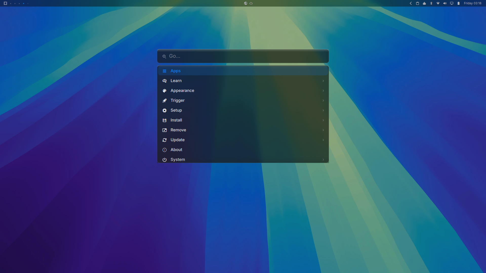
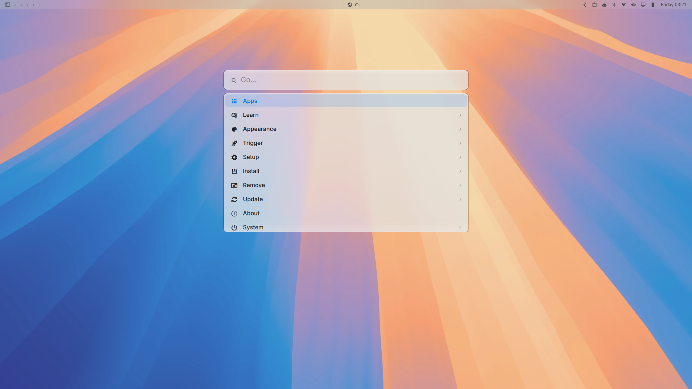

# The macOS look for Omarchy

Everything that turns an [Omarchy](https://omarchy.org/) desktop into a macOS
one: SF Pro-style typography, a frosted glass menu bar, a Spotlight-style
launcher, macOS-styled OSD, smooth view transitions, trackpad gestures, rounded
translucent windows, and the Sequoia theme.





## Install

```bash
git clone https://github.com/adhilroshan/omarchy-macos.git
cd omarchy-macos
./install.sh
```

Then pick a theme:

```bash
omarchy theme set sequoia        # dark
omarchy theme set sequoia-light  # light
```

Use `./install.sh --no-theme` to skip installing the themes.

## What it changes

| | |
|---|---|
| **Typography** | The shell (menu bar, menus, dock) and system UI (GTK interface/document fonts) render in **Inter**, the closest free stand-in for SF Pro. Terminals keep their own monospace font. |
| **Menu bar** | Glassy: Hyprland blurs the wallpaper behind it, and the clock moves to the far right like macOS. |
| **Launcher** | `Super+Space` opens a Spotlight-style search field — wide, near the top of the screen, with a magnifier, a clear button, results in a separate panel, and smooth open/filter transitions. |
| **Windows** | Rounded corners, a 1px hairline border, a soft drop shadow, and slight translucency so the wallpaper shows through. |
| **View transitions** | macOS-like easing for window open/close/move, layer/menu fades, workspace slides, and special workspaces (via Hyprland animations). |
| **OSD** | Custom compact, glass-styled on-screen display (`artr.osd`) for volume/brightness/status, replacing the stock OSD. |
| **Trackpad & gestures** | Natural scrolling (mouse + touchpad), tuned workspace swipe feel, 3-finger gestures (workspace/fullscreen/float), and 4-finger vertical volume gesture with continuous tracking. |
| **Lock screen** | Sequoia-themed unlock/lock screen images (`unlock.png`, `preview-unlock.png`) are included in the [Sequoia](https://github.com/adhilroshan/omarchy-sequoia) and [Sequoia Light](https://github.com/adhilroshan/omarchy-sequoia-light) themes (apply/update the theme to pick them up). |
| **Login & boot screens** | Optional macOS Sequoia-styled SDDM login theme and Plymouth boot colors/assets, applied via `bin/apply-login-screens` (requires sudo). |
| **Surfaces** | Menus, notifications and popups use a frosted material with light catching the top edge. |
| **Workspaces** | The workspace strip in the menu bar is a row of dots (active/occupied/empty states) instead of numbers. |
| **Dock** | Hidden, for a cleaner macOS-like desktop. |

## Themes

- [Sequoia](https://github.com/adhilroshan/omarchy-sequoia) — dark
- [Sequoia Light](https://github.com/adhilroshan/omarchy-sequoia-light) — light

Both carry Apple's macOS Sequoia system palette, the default blue accent, the
authentic macOS Sequoia wallpapers, and lock screen unlock images.

## Files it writes

```
~/.local/share/fonts/inter/                  Inter (SF Pro stand-in)
~/.local/share/fonts/nerd-symbols/           Nerd Font symbols, for the shell's icons
~/.config/fontconfig/fonts.conf
~/.config/fontconfig/conf.d/99-omarchy-inter-ui.conf
~/.config/omarchy/plugins/artr.menu/         Spotlight-style launcher
~/.config/omarchy/plugins/artr.workspaces/   dot-style workspace strip
~/.config/omarchy/plugins/artr.osd/          macOS-styled OSD plugin
~/.config/hypr/looknfeel.lua                 corners, blur, opacity, view transitions
~/.config/hypr/input.lua                     touchpad/input settings and gestures
~/.local/bin/touchpad-volume                 helper for 4-finger volume gesture
~/.config/omarchy/shell.json                 bar layout, plugin enable/disable wiring
~/.local/state/omarchy/toggles/hypr/         bar-glassy.lua, window-glassy.lua
```

This repo also ships optional initial-screen assets/helpers:
- `config/sddm/sequoia/` — Sequoia-styled SDDM login theme
- `config/plymouth/logo.png` — logo used for Plymouth theming
- `bin/apply-login-screens` — applies Plymouth + installs SDDM theme (sudo required)

To apply login/boot screen styling:

```bash
./bin/apply-login-screens dark   # or: light
```

> Note: installing/activating SDDM and Plymouth themes is system-level and may
> require sudo, SDDM config changes, and a reboot/restart of the display manager.

Each file that already exists is copied to `<file>.bak.<timestamp>` first.
Plugin directories that already exist are backed up as
`~/.config/omarchy/plugins/.<plugin>.bak.<timestamp>`.

## Undo

Every file the installer touches has a timestamped backup next to it:

```bash
# examples
ls ~/.config/hypr/*.bak.* ~/.config/omarchy/*.bak.* ~/.local/bin/*.bak.*
cp ~/.config/hypr/looknfeel.lua.bak.20260101-120000 ~/.config/hypr/looknfeel.lua
cp ~/.config/hypr/input.lua.bak.20260101-120000 ~/.config/hypr/input.lua
cp ~/.config/omarchy/shell.json.bak.20260101-120000 ~/.config/omarchy/shell.json
```

To restore a backed-up plugin directory:

```bash
rm -rf ~/.config/omarchy/plugins/artr.osd
mv ~/.config/omarchy/plugins/.artr.osd.bak.20260101-120000 ~/.config/omarchy/plugins/artr.osd
```

Then reload:

```bash
hyprctl reload
omarchy restart shell
```

To undo only the fonts and fontconfig, delete `~/.local/share/fonts/inter`,
`~/.local/share/fonts/nerd-symbols` and
`~/.config/fontconfig/conf.d/99-omarchy-inter-ui.conf`, then run `fc-cache -f`.

To revert to stock OSD behavior, restore your previous `shell.json` backup (or
remove/disable `artr.osd` and re-enable `omarchy.osd`) and restart the shell.

## Credits

- Wallpapers are Apple's macOS Sequoia artwork, redistributed as part of the
  theme for personal desktop use.
- Inter is by [Rasmus Andersson](https://rsms.me/inter/) (SIL Open Font License).
- Nerd Fonts are by [ryanoasis](https://www.nerdfonts.com/) (SIL Open Font License).
- The base theme and shell come from [Omarchy](https://omarchy.org/).

## License

MIT
